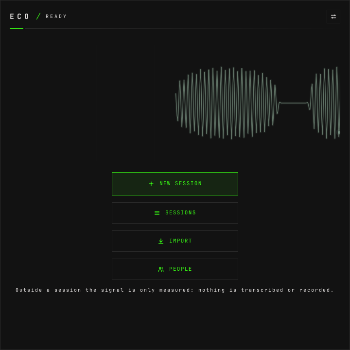
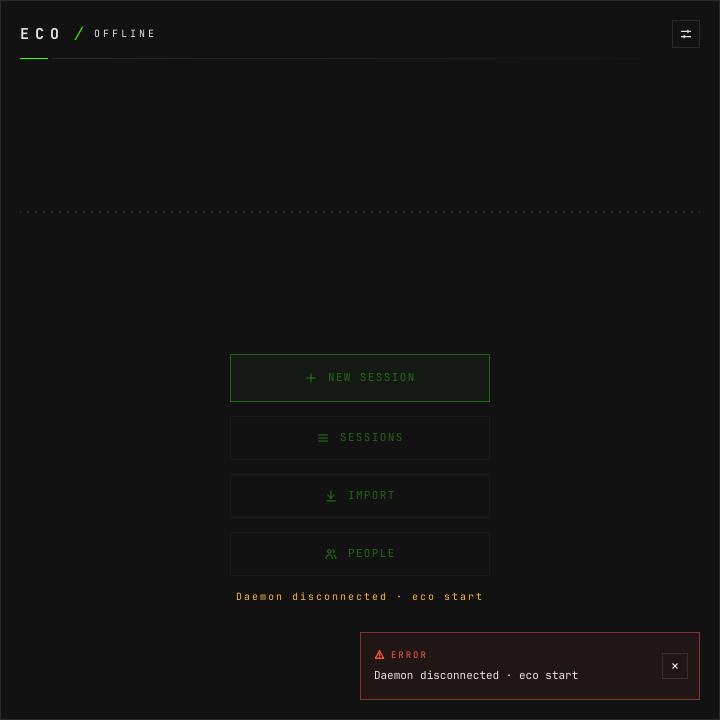

# How to install eco, and how to take it off again

**The question:** how do I get eco onto this laptop, what does it put there, and
what is left when I remove it?

This page is enough on its own. It ends with eco installed from its package,
its window open, and the one command that takes it back off. Registering models
and choosing what eco hears are their own pages; this one only gets the program
on the machine.

---

## What it needs

- **Omarchy**, or Arch with Hyprland, PipeWire and a systemd user session. eco is
  released for Linux only. The Hyprland config it ships is Lua (`o.bind`, `o.window`).
- **PipeWire's tools**: `pw-record` captures, `pw-dump` lists the devices.
- **Qt 6** (`qt6-base`, `qt6-declarative`), which draws the window. Omarchy
  already has it, and the package depends on it.
- **`ffmpeg` and `ffprobe`**, only to import audio or video files.
- **`wl-copy`**, to copy an answer or a transcript to the clipboard.
- **A key for each paid provider you use** — OpenRouter for answers, Deepgram or
  ElevenLabs for live transcription — or a model server of your own.
  [How to register models](how-to-register-models.md) is the next page.

---

## 1. Install the package

Not published as an Omarchy default yet. From the latest GitHub release:

```bash
curl -fsSL https://raw.githubusercontent.com/This-Is-NPC/eco/master/install.sh | bash
VERSION=0.1.0 bash install.sh    # a release other than the latest
```

Every GitHub release carries the Arch package and a `SHA256SUMS` beside it.
`install.sh` downloads the package, refuses it when the checksum does not match,
and installs it with `pacman -U`.

**Installing a newer release is the upgrade.** `pacman -U` replaces the last
one. A daemon that was running goes on running the old binary until
`eco restart`, which also reopens its window if it was open.

## 2. Download its models

```bash
eco setup --harnesses agents,claude-code
```

`eco setup` downloads the two models eco runs on the laptop — Silero VAD, which
finds speech, and WeSpeaker CAM++, which tells voices apart — checks each
against a pinned checksum, loads eco's Hyprland rules (step 4) and publishes the
`eco` skill for agents:

```
eco: saved /home/you/.local/share/eco/models/silero_vad.onnx
eco: saved /home/you/.local/share/eco/models/wespeaker_campplus.onnx
eco: Hyprland rules added in /home/you/.config/hypr/bindings.lua; `hyprctl reload` loads them
eco: skill /home/you/.agents/skills/eco/SKILL.md installed
eco: skill /home/you/.claude/skills/eco/SKILL.md installed
```

Run again, it downloads and changes nothing:

```
eco: /home/you/.local/share/eco/models/silero_vad.onnx is up to date
eco: /home/you/.local/share/eco/models/wespeaker_campplus.onnx is up to date
eco: Hyprland rules in /home/you/.config/hypr/bindings.lua are up to date
eco: skill /home/you/.agents/skills/eco/SKILL.md is up to date
eco: skill /home/you/.claude/skills/eco/SKILL.md is up to date
```

`/home/you` throughout this page stands for your home directory.

## 3. Register the models in the window

There is no config to write by hand. Without `~/.config/eco/config.toml` the
daemon starts with an empty one: no model, no audio source, the defaults for
the rest. Start eco (step 5) and its window opens; `SUPER+ALT+C` opens the
settings. **Models** registers a transcription model and a chat model, each
with where its key comes from ([how to register models](how-to-register-models.md)),
and **Audio** says who is heard
([how to set up audio sources](how-to-set-up-audio-sources.md)). The settings
ask for a default transcription model and the assistant's model before they
save, and the first save writes the file; from then on the settings window
edits it. Every field is in [`design.md` §9](design.md#9-configuration).

Until then, what needs a model says so: a session started transcribes nothing
and says `no transcription model is chosen`, and an answer fails with `no chat
model is chosen`. A model whose key is missing does not stop the daemon
either: everything else works, and what uses that model says why.

## 4. Load the Hyprland rules

The package carries eco's Hyprland rules and keys as one Lua file,
`/usr/share/eco/hypr/eco.lua`. **`eco setup` (step 2) already did this step:**
it added one line to the end of `~/.config/hypr/bindings.lua`
(`$XDG_CONFIG_HOME/hypr/bindings.lua` when that is set) that loads it:

```lua
do local eco = "/usr/share/eco/hypr/eco.lua"; local file = io.open(eco, "r"); if file then file:close(); dofile(eco) end end -- eco setup
```

The line loads the file only while it exists, so Hyprland does not fail on it
once the package is removed. Run `hyprctl reload` to load the rules now.

`eco setup` writes nothing else in your Hyprland config, and it writes this line
only once. Before it changes the file it keeps a copy beside it,
`bindings.lua.bak.<seconds>` (the Unix time, a placeholder here), as Omarchy's
own tools do. A `bindings.lua` it cannot read or write is a warning: the rest of
setup still runs, and it exits with status 1. It leaves the file alone in two
cases, and says so:

- **A line already names an `eco.lua`** — your own `dofile`, say:

  ```
  eco: /home/you/.config/hypr/bindings.lua already loads an eco.lua; left as is
  ```

- **There is no `bindings.lua`**, as in a Hyprland config that is not
  Omarchy's. It does not create one; it prints the line, and you put it in the
  Lua file your config loads:

  ```
  eco: no /home/you/.config/hypr/bindings.lua; add this line to your Hyprland config to load eco's rules: do local eco = …
  ```

**To stop loading the rules,** put `--` in front of the line, which makes it a
comment. A commented line names an `eco.lua`, so `eco setup` leaves it as it is
from then on. Deleting the line works too, until the next `eco setup` adds it
back.

Without the rules Hyprland tiles the window like any other. With it, the window floats,
is pinned to every workspace and keeps the size you give it, and the settings
window opens centred above it. It also binds the global keys:

| keys | what |
|---|---|
| `SUPER+ALT+N` | new session |
| `SUPER+ALT+P` | pause or resume the session shown |
| `SUPER+ALT+H` | the sessions list |
| `SUPER+ALT+C` | open or close the settings |
| `SUPER+ALT+E` | bring eco to the front |
| `SUPER+ALT+A`, `SUPER+ALT+Q` | run the skills named `ask` and `probe` |

Each key runs an `eco window` command, which hands one line to the running
daemon; none of them starts a second daemon. Those that open a view give eco
the keyboard. The last row only works if you have skills by those names —
[how to write skills](how-to-write-skills.md) binds your own.

## 5. Start it

```bash
eco start
```

```
eco: window opened
```

Or open **eco** from the launcher, which runs the same command. `eco start`
starts the user service when nothing answers on the socket, waits for the
daemon, and asks it for a window. Each `eco start` opens one more window.



The trace moving is the check that capture works. Outside a session that is all
eco does with the audio: it measures it, and transcribes and keeps nothing.

The rest of the daemon's verbs:

```bash
eco start --headless   # the daemon only, no window: "eco: daemon running"
eco stop               # "eco: daemon stopped"
eco restart            # stop, start, and reopen the window if it was open
eco status
```

```
eco: daemon running (pid 434054, version 0.1.0)
```

`eco status` prints `eco: daemon stopped` and exits 3 when nothing answers, so a
script can test it.

**The service is not enabled.** The package carries the unit, and nothing more:
the daemon is not running after a login until `eco start` or the launcher
starts it. A crash restarts it (`Restart=on-failure`).

---

## On Windows

eco runs on 64-bit Windows (tested on Windows 11 build 26100) from a zip with the program, its
window and the Qt it draws with. It needs the Microsoft Visual C++
Redistributable (x64), which most machines already have. There is no
installer and no release download yet: `mise run package` on a Windows
machine with a checkout writes `dist\eco-<version>-windows-x86_64.zip`
(`<version>` is a placeholder for the version in `Cargo.toml`, `0.2.0` here;
[how it is built](design.md#13-packaging)).

1. **Unzip it** where programs of your own go. The zip holds one folder,
   `eco`; keep it whole, the program finds its window and overlay inside it:

   ```powershell
   Expand-Archive eco-0.2.0-windows-x86_64.zip -DestinationPath "$env:LOCALAPPDATA\Programs"
   ```

2. **Put its `bin` folder on your `PATH`,** for your account only, then open a
   new terminal:

   ```powershell
   $bin = "$env:LOCALAPPDATA\Programs\eco\bin"
   [Environment]::SetEnvironmentVariable("Path", [Environment]::GetEnvironmentVariable("Path", "User") + ";$bin", "User")
   eco --version          # "eco 0.2.0"
   ```

   Only `eco.exe` is in `bin`; the window and its Qt stay in `lib\eco`.
   To upgrade, `eco stop`, delete the `eco` folder and unzip the new one in
   its place; `PATH` and the login script still point at it.

3. **Download the models,** start eco at login and add it to the Start menu,
   as step 2 does on Linux:

   ```
   > eco setup
   eco: C:\Users\you\AppData\Local\eco\models\silero_vad.onnx is up to date
   eco: C:\Users\you\AppData\Local\eco\models\wespeaker_campplus.onnx is up to date
   eco: login start added in C:\Users\you\AppData\Roaming\Microsoft\Windows\Start Menu\Programs\Startup\eco.cmd; eco starts with your next login
   eco: Start menu entry added in C:\Users\you\AppData\Roaming\Microsoft\Windows\Start Menu\Programs\eco.lnk
   ```

   (`C:\Users\you` stands for your profile directory.) A first run says
   `saved` and the path for each model instead of `is up to date`.

4. **There is no config to write.** As step 3 says for Linux, eco starts
   with an empty config, and the settings write `%APPDATA%\eco\config.toml`
   at the first save.

5. **Give it the keys** as environment variables of your account. `setx`
   keeps them for programs started after it, so open a new terminal, and
   `eco restart` a daemon that was running:

   ```powershell
   setx OPENROUTER_API_KEY "<your key>"
   setx DEEPGRAM_API_KEY "<your key>"
   ```

   `<your key>` is a placeholder. Without them eco still starts (seen on
   the machine eco was built on); what needs a model says
   `DEEPGRAM_API_KEY is not set` or `OPENROUTER_API_KEY is not set` (read in
   the code). omapass keeps its secrets in a keyring
   Windows does not have, so a model with `api_key_omapass` says `omapass is
   not available on Windows`.

6. **Start it:** open **eco** from the Start menu, or in a terminal:

   ```powershell
   eco start              # "eco: window opened"
   eco start --headless   # "eco: daemon running", without a window
   eco status             # "eco: daemon running (pid 7840, version 0.2.0)"
   eco stop               # "eco: daemon stopped"
   ```

The daemon's verbs are the same as on Linux, with one difference: it runs as
a process of your own in the background rather than a service. These outputs
are from the zip, unpacked and run with data folders of its own on the machine
eco was built on, which is reached over ssh: the models were copied in first,
so `eco setup` found them up to date, and the window opened offscreen
(`QT_QPA_PLATFORM=offscreen`), not on a desktop.

**From a checkout** eco runs as well: its window is then
`target\window\eco-window.exe`, which `mise run window:build` builds, putting
Qt into the checkout the first time;
[how it is built](design.md#working-on-eco) says what Windows needs for that.
Without the window, `eco start` starts the daemon, then fails to open the
window with `Error: eco window failed:` and the path it looked for.

**To install from a checkout,** in place of steps 1 to 3, run
`mise run install:windows`. It builds eco and its window, puts the same `eco`
folder the zip holds in `%LOCALAPPDATA%\Programs\eco`, adds its `bin` to your
`PATH` (your account's, not the machine's) and runs `eco setup`:

```
> mise run install:windows
[qt:install] $ python scripts/qt-install
[window:build] sources up-to-date, skipping
[install:windows] $ python scripts/install-windows
installed eco in C:\Users\you\AppData\Local\Programs\eco
added C:\Users\you\AppData\Local\Programs\eco\bin to your PATH; a new terminal finds eco
eco: C:\Users\you\AppData\Local\eco\models\silero_vad.onnx is up to date
eco: C:\Users\you\AppData\Local\eco\models\wespeaker_campplus.onnx is up to date
eco: login start added in C:\Users\you\AppData\Roaming\Microsoft\Windows\Start Menu\Programs\Startup\eco.cmd; eco starts with your next login
eco: Start menu entry added in C:\Users\you\AppData\Roaming\Microsoft\Windows\Start Menu\Programs\eco.lnk
```

Open a new terminal for the new `PATH`. Running it again is the upgrade: it
says `…\eco\bin is on your PATH already` and adds no second entry. A daemon
that was running is stopped before the files are replaced and started again
after, `eco: daemon stopped` then `eco: daemon running`. Sessions, config and
models stay. On Linux the task refuses and names `mise run install`.

**To take it off again,** run `mise run uninstall:windows`. It asks:

```
> mise run uninstall:windows
[uninstall:windows] $ python scripts/uninstall-windows
1) uninstall eco, keep sessions, config and models
2) uninstall and delete everything
Choose 1 or 2: 1
removed C:\Users\you\AppData\Local\Programs\eco
removed C:\Users\you\AppData\Roaming\Microsoft\Windows\Start Menu\Programs\Startup\eco.cmd
removed C:\Users\you\AppData\Roaming\Microsoft\Windows\Start Menu\Programs\eco.lnk
removed C:\Users\you\AppData\Local\Programs\eco\bin from your PATH
kept C:\Users\you\AppData\Local\eco
```

It stops the daemon and its window first. `2` asks again, `Type delete to
delete your sessions, config and models:`, and only the word `delete` goes
on; then it also removes `%APPDATA%\eco` and `%LOCALAPPDATA%\eco`: the config,
the sessions, the people, the models, the token and the log. Any other answer
says `nothing removed` and removes nothing. `mise run uninstall:windows
--keep-data` and `mise run uninstall:windows --delete-everything` answer
without asking. These outputs are from the machine eco was built on; the
delete was run with `APPDATA` and `LOCALAPPDATA` pointing at folders of its
own.

**The window may open behind the others.** Windows brings a window to the
front only for a program that has the foreground or was given it, and the
daemon runs in the background, so a window it opens or focuses may stay behind
and flash in the taskbar instead; click it there. This is read in Windows'
rules, not seen: the machine eco was built on is reached over ssh, with no
desktop.

**Global shortcuts.** There is no Hyprland on Windows: the daemon registers
the keys itself, those of Linux with the Windows key for SUPER. None is a key
Windows keeps for itself: `Win+Alt` with a digit opens a taskbar jump list, and
the Game Bar holds `Win+Alt+G`, `M`, `R` and `T`.

| Keys | What they do |
|---|---|
| `Win+Alt+N` | open the dialog that starts a session |
| `Win+Alt+H` | the sessions |
| `Win+Alt+C` | the settings |
| `Win+Alt+P` | pause or resume the session shown |
| `Win+Alt+E` | bring eco to the front |
| `Win+Alt+A`, `Win+Alt+Q` | run the skills `ask` and `probe` |

Other keys go under `[shortcuts]` in `%APPDATA%\eco\config.toml` (create the
file if it is missing; the settings window has no place for them), each the
keys and the `eco window` command they run; the table replaces the defaults,
and an empty one binds none ([the configuration](design.md#9-configuration)):

```toml
[shortcuts]
"Win+Alt+A" = "action ask"
"Ctrl+Alt+M" = "sessions"
```

The keys are read when the daemon starts: `eco restart` after a change. Keys
another program holds are not taken from it; the window says so as it
connects, and the daemon's log too, with the config's path in your profile in
place of `<config>`:

```
eco: Win+Alt+A is taken by another program; choose other keys under [shortcuts] in <config> (create the file if it is missing), then run eco restart
```

A daemon started where there is no desktop, over ssh say, has every key
refused and says so for each. On a desktop, `Win+Alt+C`, `N`, `H` and `E`
were pressed and worked; `Win+Alt+A` and `Q` were chosen after `Win+Alt+1` and
`2` were refused there, and were not pressed on a desktop yet.

**Hiding from screen sharing** (**Settings › Interface › HIDE FROM SCREEN
SHARING**) leaves eco's windows out of every capture, your own screenshots and
recordings too; Microsoft documents this for Windows 10 2004 and later
(read, not seen).

**The daemon's output** goes to `%LOCALAPPDATA%\eco\daemon.log`, emptied each
time `eco start` starts it. A daemon that will not start says why there, and
`eco start`, after waiting 10 seconds for it, repeats that line:

```
Error: the daemon was started, but did not open the socket; it said:
  eco: missing C:\Users\you\AppData\Local\eco\models\silero_vad.onnx; run `eco setup`
```

Only a line the daemon starts with `eco: ` or `Error: ` is repeated; the rest
of the log stays in the file.

(`C:\Users\you` stands for your profile directory.)

**Starting at login.** On Windows `eco setup` writes a script into your Startup
folder, which Windows runs as you log in, in place of the Hyprland line of
step 4:

```
eco: login start added in C:\Users\you\AppData\Roaming\Microsoft\Windows\Start Menu\Programs\Startup\eco.cmd; eco starts with your next login
```

Run again, it says `login start in … is up to date`; run from an eco that has
moved, it rewrites the script to start the new one (`login start updated in
…`). The script runs `eco start --headless` for the eco that wrote it; Windows
runs a script in a console window, which stays while `eco start` waits for the
daemon. A
script it cannot write is a warning, and `eco setup` exits with status 1.

**To stop starting at login,** delete the script:

```powershell
Remove-Item "$env:APPDATA\Microsoft\Windows\Start Menu\Programs\Startup\eco.cmd"
```

**The Start menu.** `eco setup` also adds the shortcut **eco** to your Start
menu, with eco's icon:

```
eco: Start menu entry added in C:\Users\you\AppData\Roaming\Microsoft\Windows\Start Menu\Programs\eco.lnk
```

It runs `eco start` through `conhost.exe --headless`, a console host that
shows no window, so no console stays open while `eco start` waits for the
daemon and its window. Run again, it says `Start menu entry … is up to date`;
from an eco that has moved, `Start menu entry updated in …`. The shortcut is
written through PowerShell; one it cannot write is a warning, and `eco setup`
exits with status 1. Over ssh the shortcut's command was run and started and
stopped the daemon; a click in the Start menu was not seen, as the machine
eco was built on has no desktop at hand.

**To take eco off Windows** with a checkout at hand, `mise run
uninstall:windows` above does it all. Without one, stop it, delete the login
script, the folder you unzipped (or the checkout), and its `bin` folder from
your `PATH`:

```powershell
eco stop
Remove-Item "$env:APPDATA\Microsoft\Windows\Start Menu\Programs\Startup\eco.cmd"
Remove-Item "$env:APPDATA\Microsoft\Windows\Start Menu\Programs\eco.lnk"
Remove-Item -Recurse "$env:LOCALAPPDATA\Programs\eco"
```

Remove the `PATH` entry in **Settings › System › About › Advanced system
settings › Environment Variables**. Your config is in `%APPDATA%\eco` and the
sessions, people, models and log in `%LOCALAPPDATA%\eco`; delete those
folders to remove them too. A key you gave with `setx` stays until you remove
it, one command each:

```powershell
[Environment]::SetEnvironmentVariable("OPENROUTER_API_KEY", $null, "User")
```

---

## What the install puts on the machine

The package owns these; `pacman -Ql eco` lists every file and where it is:

- the `eco` binary;
- its window, the QML the daemon launches;
- the Hyprland rules and keys, `eco.lua`;
- the launcher and its icon;
- the bash, zsh and fish completions of `eco`, which complete through the
  `usage` command the package depends on;
- the licence;
- the user service, which runs `eco daemon --headless`.

`eco setup` (step 2) writes these in your home, and they are not the package's:

| what | where |
|---|---|
| the VAD and speaker models | `~/.local/share/eco/models/` |
| the agent skill | `~/.agents/skills/eco/SKILL.md` and `~/.claude/skills/eco/SKILL.md` |
| the line loading the Hyprland rules | the end of `~/.config/hypr/bindings.lua` |

And what eco writes as it is used, which is yours and not the install's:

| what | where |
|---|---|
| the config | `~/.config/eco/config.toml` |
| the sessions, one append-only log each | `~/.local/share/eco/sessions/` |
| the people you named, and their voices | `~/.local/share/eco/people/` |

**No audio is ever written.** A session's log is text: lines, notes, answers.
Voices are kept as numbers that describe them, not as sound.
[`design.md` §8](design.md#8-state-on-disk) lists every file.

The skill is how an agent learns the `eco` command line. `eco setup` refreshes
the copies it owns and never overwrites a file at those paths that it did not
write.

---

## Taking it off

```bash
eco stop
sudo pacman -R eco
```

`eco stop` ends the daemon; `pacman -R` then removes everything the package
put on the machine: the binary, the window, the Hyprland rules, the launcher,
the icon, the completions, the licence and the user service.

**The line `eco setup` added to `~/.config/hypr/bindings.lua` stays,** and
does nothing: it loads the rules only while the file exists. To remove it too,
delete the line that ends in `-- eco setup`.

**Kept on purpose:** the config, the sessions, the people, the models and the
agent skill. Removing the program is not a reason to lose a year of meetings.
To remove those too:

```bash
rm -rf ~/.config/eco ~/.local/share/eco
rm -rf ~/.agents/skills/eco ~/.claude/skills/eco
```

Keys you put in `~/.config/uwsm/env` stay there until you delete those lines.

---

## What can go wrong

**The models are missing.** The daemon will not start without them, and says
which:

```
eco: missing /home/you/.local/share/eco/models/silero_vad.onnx; run `eco setup`
```

`eco start` waits 10 seconds for the daemon, then repeats the line it left in
the journal of `eco.service`:

```
Error: the daemon was started, but did not open the socket; it said:
  eco: missing /home/you/.local/share/eco/models/silero_vad.onnx; run `eco setup`
```

**The config does not validate.** The daemon names the rule it broke, one line,
and does not start:

```
eco: a provider's key comes from api_key_env or api_key_omapass, not both
```

**The window says OFFLINE.** Its start screen adds `Daemon disconnected · eco
start`: nothing answers on `$XDG_RUNTIME_DIR/eco.sock`. `eco status`, then
`eco start`; the window reconnects on its own. Service failures
are in `journalctl --user -u eco.service`.



---

## Next

- [How to register models](how-to-register-models.md) — the keys, and which
  model transcribes and which answers.
- [How to set up audio sources](how-to-set-up-audio-sources.md) — who eco hears,
  and which voice is yours.
- [The command line](cli.md) — every command and flag.
