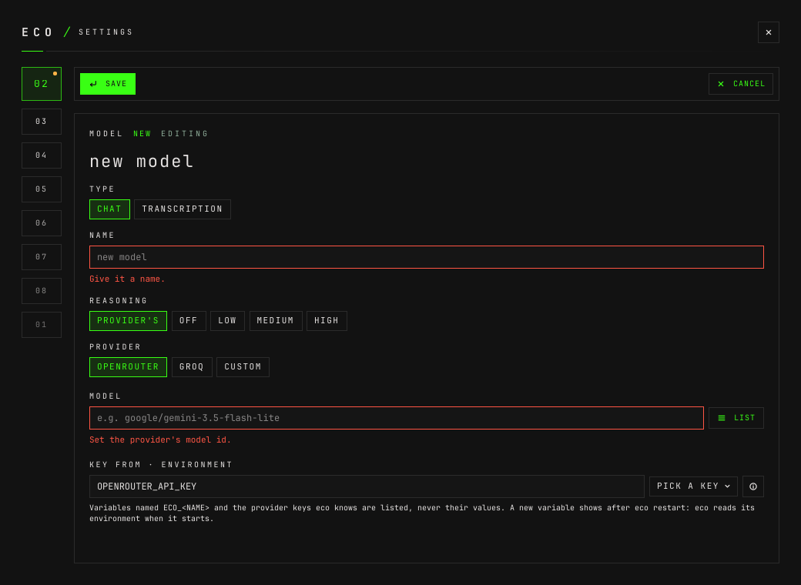

# How to register models

**The question:** eco needs one model to transcribe, and one to answer and
translate if you want answers. Where do the keys go, how do I add a model, and
how do I say which one does what?

This page is enough on its own. It ends with a chat model on OpenRouter and a
transcription model registered, each with its key, and an answer that proves the
chat one works. A model served from a machine on your own network is its own
page: [how to use a model on the LAN](how-to-use-a-model-on-the-lan.md).

---

A **model** is registered once, in the **Models** section of the settings: a
name of yours, a type — **chat** or **transcription** —, the provider and the
provider's id for it, and where its key comes from. The Models table also
makes a model the default for chat, translation, review or transcription;
skills and session kinds may pick another by its name, and never repeat
a provider or a key. Answers go through one adapter, the
OpenAI-compatible API, so the provider is only a base URL: OpenRouter, Groq, or a
server of your own.

## Before you start

- **eco is installed and its window is open.**
  [How to install it](how-to-install-and-remove.md).
- **A key from each paid provider you will use.** OpenRouter
  (`openrouter.ai`) for answers; Deepgram or ElevenLabs for live transcription,
  or Groq or OpenAI for transcription phrase by phrase.
- **For Deepgram's cost, a key with the `usage:read` scope.** Deepgram tells
  what a request cost only to a key that has it. Without it eco still
  transcribes, and the cost of that audio is unknown unless the model has a
  price per minute ([how to read what a session cost](how-to-read-what-a-session-cost.md)).
- **Optional: omapass**, the Omarchy password plugin, if you would rather keep
  the keys in your keyring than in a file. eco works without it; [its plugin
  page](https://plugins.omarchy.org/plugin.html?id=io.github.this-is-npc.omapass)
  says how to install it.

---

## 1. Put the key where the daemon can read it

Only the daemon reads keys. The window never holds one, and no key is ever
written to a log. There are two places it can come from on Linux, and two on
Windows: the environment, and omapass on Linux or the Windows Credential
Manager on Windows.

**From the environment.** The daemon is usually started from the launcher or a
Hyprland key, which do not read `.bashrc`, so put the keys in
`~/.config/uwsm/env`, which the whole Omarchy session reads:

```bash
export OPENROUTER_API_KEY=sk-or-…
export DEEPGRAM_API_KEY=…
```

The variables eco's presets name are `OPENROUTER_API_KEY`, `DEEPGRAM_API_KEY`,
`ELEVEN_LABS_API_KEY`, `GROQ_API_KEY` and `OPENAI_API_KEY`. A new value reaches
the daemon once the session has read the file again: log out and back in, then
`eco restart`.

**A key of your own: name it `ECO_<NAME>`.** `<NAME>` is a placeholder for a
name of yours, such as `ECO_LAN_KEY`. The model form lists every variable named
`ECO_<NAME>` and the presets' variables that are set, by name only, never their
values; any other variable still works when its name is typed. eco's own
variables (`ECO_SOCKET`, `ECO_TOKEN`, `ECO_WINDOW` and the others it sets for
its windows and hooks) are never listed. The daemon reads its environment when
it starts, so a new variable is listed after `eco restart`:

- **On Linux,** add `export ECO_LAN_KEY=…` to `~/.config/uwsm/env`, log out and
  back in, then `eco restart`.
- **On Windows,** add it under **Settings › System › About › Advanced system
  settings › Environment Variables › User variables** (or run
  `setx ECO_LAN_KEY "…"` in a terminal), then restart eco from a new terminal
  or the Start menu, so it starts with the new environment: `eco restart`.
- **On macOS,** run `launchctl setenv ECO_LAN_KEY "…"`, which lasts until you
  log out, then `eco restart`
  ([on macOS](how-to-install-and-remove.md#on-macos)).

`eco key list` prints the names the daemon can read, as JSON:

```
$ eco key list
{"ok":true,"data":{"env":["ECO_LAN_KEY","OPENROUTER_API_KEY"],"credentials":null,"omapass":["openrouter"]}}
```

`credentials` is `null` on Linux and `omapass` is `null` without omapass
(always on Windows). That output is read in the code, not run here.

**From omapass.** Save the key as a password in omapass, under an account name
such as `openrouter`. eco runs `omapass get -- openrouter` each time it builds
that provider — on start, and on every save of the settings — reading the secret
through a pipe. Nothing to restart, and nothing in a file. eco finds omapass on
`PATH` or where Omarchy installs the plugin.

**From the Windows Credential Manager** (Windows only). Keep the key as the
generic credential `eco:<name>`, where `<name>` is a name of yours such as
`deepgram`, and the model names it. eco reads it each time it builds that
provider. Store it from a terminal; it asks for the key without showing it,
or reads it from stdin when piped:

```
> eco key set deepgram
Key for eco:deepgram (hidden):
eco: the key is in the Windows Credential Manager as eco:deepgram
```

Or add it by hand. Open the Credential Manager — search the Start menu for
**Credential Manager** (**Gerenciador de Credenciais** in Portuguese), or
**Control Panel › User Accounts › Credential Manager**, or run
`control /name Microsoft.CredentialManager` — then **Windows Credentials ›
Add a generic credential**: **Internet or network address** `eco:deepgram`,
any **User name**, the key as the **Password**. `eco key remove deepgram`
deletes it. A daemon that was running reads a new credential after
`eco restart`. The model form lists the `eco:<name>` credentials by name as
soon as they exist, without a restart, since the daemon searches the
Credential Manager each time the list opens. Those outputs are read in the code, not seen: an ssh login by
key, the only way into the machine eco was built on, has no Credential
Manager ([on Windows](how-to-install-and-remove.md#on-windows)). On Linux and
macOS, `eco key` says `the Windows Credential Manager is only on Windows; keep
the key in an environment variable (api_key_env), or on Omarchy in omapass
(api_key_omapass)`. eco does not use the macOS Keychain: it ties each key to
the program's signature, and eco is not signed, so every new build would ask
for each key again.

## 2. Add a chat model

Open the settings (`SUPER+ALT+C`), then **Models**, section 02 (`Ctrl+2`). It
is a table of the models registered: each one's name, type, the provider's
model id, what it is the default for and what else uses it.

![The Models section: the rail of sections down the left, with 02 marked; the bar with ADD MODEL, VIEW, EDIT, the defaults by their short names, a dimmed FOR CHAT, a dimmed FOR TRANSLATION and FOR REVIEW, and a dimmed DELETE; "Register each model once — chat or transcription — with its provider, and make it a default from the bar"; and a table of whisper-lan (TRANSCRIPTION, whisper-large-v3-turbo, default TRANSCRIPTION, used by MEETING, CONVERSATION…), deepgram (TRANSCRIPTION, nova-3, INTERVIEW), gemini-flash (CHAT, google/gemini-2.5-flash, default CHAT · TRANSLATION, MEETING…, picked) and claude-haiku (CHAT, anthropic/claude-haiku-4.5, default REVIEW, minutes).](img/41-settings-models.png)

**A chat model is optional.** Without one eco records, transcribes and keeps
notes; the **Prompts**, **Context** and **Skills** sections say NO CHAT MODEL
above their tables, with **REGISTER A CHAT MODEL** back here, and what needs one
— asking, skills, translation, context slots, the reviewer, a kind's assistant
and translation pickers — stays on screen, dimmed, its hint saying why. Skip to
step 3 if you only want transcripts.

**ADD MODEL** opens a new model, marked NEW and EDITING, starting from the
provider and key source of the last model of its type. The first model of its type
becomes that type's default on save; any other is the default of nothing until
step 4 makes it one. Fill it top to bottom:

- **TYPE** — **CHAT**. It can change only while nothing uses the model.
- **NAME** — yours, such as `gemini`. It is what every other section shows.
  Renaming it later renames it everywhere.
- **REASONING** — how long the model thinks before it answers:
  **PROVIDER'S** (the provider decides), **OFF**, **LOW**, **MEDIUM** or
  **HIGH**. **OFF** starts the answer at once, which is what a live
  conversation wants; some models require reasoning and fail without it. It is
  sent as OpenRouter's `reasoning` field.
- **PROVIDER** — **OPENROUTER**, **GROQ**, or **CUSTOM** for any other
  OpenAI-compatible base URL.
- **MODEL** — the provider's id, such as `google/gemini-3.5-flash-lite`. Type
  it, or press **LIST** to ask the provider which models it offers and pick one;
  the list filters as you type.
- **KEY FROM** — the key's name, picked with **PICK A KEY**: one list, a
  title per source, of the names step 1 put where the daemon reads them —
  **ENVIRONMENT** (the `ECO_<NAME>` variables and the presets' variables that
  are set), then **OMAPASS** (its accounts) on Linux when omapass is
  installed, or **CREDENTIAL MANAGER** (the `eco:<name>` credentials) on
  Windows. Only names are listed, never a secret. **TYPE A NAME…** under a
  source keeps that source and lets you type a name the list does not show.
  Without omapass on the machine, an info button beside the picker opens
  omapass's install page in the browser. With a credential named, a line says
  how to store that key with `eco key set` or by hand.
- **EXTRA (JSON)** — extra fields sent with every request, as a JSON object, such as
  `{"temperature": 0.2}`. A reasoning chosen above wins over one written here.

**SAVE** (`Ctrl+S`) saves this model alone. A toast says
`settings saved`, and the model's screen shows it read. A save with a field
missing marks that field and saves nothing:



A registered model, read: ABOUT says what it is and what it is the default
for, and RELATED what else uses it, each a link to where that use is set. **EDIT** (`Ctrl+E`) opens the same form; a model
in use has no TYPE row.


**BACK** returns to the table.

## 3. Add a transcription model

**ADD MODEL** again, **TYPE** **TRANSCRIPTION**. The provider presets are:

| preset | how it transcribes | key |
|---|---|---|
| **DEEPGRAM** (`nova-3`) | streaming: words appear as they are said | `DEEPGRAM_API_KEY` |
| **ELEVENLABS** (`scribe_v2_realtime`) | streaming | `ELEVEN_LABS_API_KEY` |
| **GROQ** (`whisper-large-v3-turbo`) | one phrase at a time, once it ends | `GROQ_API_KEY` |
| **OPENAI** (`whisper-1`) | one phrase at a time | `OPENAI_API_KEY` |

The base URL decides how: a `wss://` URL streams, an `http(s)://` one is the
OpenAI-compatible `/v1/audio/transcriptions`. How fast each is, measured, is in
[benchmarks](benchmarks.md).

A transcription model takes one more field, **FALLBACK PRICE PER MINUTE, USD
(OPTIONAL)**. Leave it empty unless the provider reports no cost of its own; it
only stands in where nothing else does. **SAVE**.

## 4. Say which model does what

**The first model of each type is its default.** Register one chat model and
one transcription model and each is already the default of its type (DEFAULT
FOR CHAT and DEFAULT FOR TRANSCRIPTION); a second model of a type does not
replace it. Deleting a default's model is refused (see below); a saved config
that loses it makes the first remaining model of that type the default.

**Any other default is set on the Models table.** Pick a model and press, in
the bar:

| model | command | sets | used by |
|---|---|---|---|
| chat | **DEFAULT FOR CHAT** | `[llm] model` | the assistant: questions, and the skills and session kinds that pick no model |
| chat | **DEFAULT FOR TRANSLATION** | `[translation] model` | translations in sessions whose kind picks no translation model |
| chat | **DEFAULT FOR REVIEW** | `[reviewer] model` | the reviewer, which rewrites every answer before it shows while REVIEW ANSWERS is on |
| transcription | **DEFAULT FOR TRANSCRIPTION** | `[stt] model` | sessions whose kind picks no transcription model |

Each saves at once; the DEFAULT column then says so. A command is dimmed on
the model that is already that default. Until a translation default is set,
the chat default translates, and its DEFAULT reads CHAT · TRANSLATION
(INHERITED).

DEFAULT FOR REVIEW only picks the reviewer's model; it does not turn review on.
That is **REVIEW ANSWERS**, under the title REVIEWER in **General** (`Ctrl+8`),
an ON/OFF saved at once; its row names the reviewer's model beside the value.
Turned on with no reviewer model picked, the chat default reviews.

**Anything more specific picks in its own section.** Open the item, **EDIT**,
pick, **SAVE**:

| section | item | picks |
|---|---|---|
| **Session kinds** (`Ctrl+4`) | each kind | per kind of session, its own transcription, assistant and translation models |
| **Skills** (`Ctrl+7`) | each skill | a model per skill, or the default |


**A kind can run on its own models.** Open a kind in **Session kinds** to give it a
transcription, assistant and translation model of its own — an `idea` session on
a free model, an interview on the best one. A skill that names a model answers
with it in every kind.

**No fallback.** If a model is down, what uses it says so; eco never quietly
answers with another one.

## 5. Check it

Ask any session a question from a terminal:

```bash
eco ask c7fe3528d507 who tells the pilot customers?
```

```
{"ok":true,"data":{"session":"c7fe3528d507","id":"1e903aa0","action":"chat","prompt":"who tells the pilot customers?","model":"google/gemini-3.5-flash-lite","text":"Leo.","ttft_ms":1538,"total_ms":1627}}
```

`c7fe3528d507` is a session id, a placeholder here: `eco sessions` lists yours.
`model` is the provider's id of the model that answered, and `ttft_ms` how long
the first word took.

---

## In the config file

What the settings window writes to `~/.config/eco/config.toml` for the steps
above:

```toml
[stt]
model = "deepgram"                     # the default transcription model

[llm]
model = "gemini"                       # the default assistant

[[models]]
name = "gemini"
type = "chat"
base_url = "https://openrouter.ai/api/v1"
model = "google/gemini-3.5-flash-lite"
api_key_env = "OPENROUTER_API_KEY"     # or api_key_omapass = "openrouter", or api_key_credential = "openrouter"; one
reasoning = "off"

[[models]]
name = "deepgram"
type = "transcription"
base_url = "wss://api.deepgram.com/v1/listen"
model = "nova-3"
api_key_omapass = "Deepgram"
```

`kinds = ["idea"]` on a model makes it that kind's model of its type;
`extra = { … }` is EXTRA (JSON). Every field: [`design.md` §9](design.md#9-configuration).

---

## What can go wrong

**The key is not set.** The daemon still starts, and everything that does not
use that model works. An error toast in the window says
`Model gemini unavailable: OPENROUTER_API_KEY is not set. Everything else works;
what uses this model fails until it is fixed in Settings › Models.` From the
command line, a skill on that model fails the same way:

```
{"ok":false,"code":"completion.failed","message":"probe: OPENROUTER_API_KEY is not set"}
```

A transcription model in the same state leaves the inputs measured and nothing
transcribed, and says `Transcription unavailable: …`.

**omapass is not installed.** **PICK A KEY** lists no **OMAPASS**; the info
button beside it opens the install page. A model whose key already comes from
omapass says `omapass is not installed.` under **KEY FROM**; pick a key from
another source, or install omapass. The daemon, building that provider,
fails with
`omapass is not installed (https://plugins.omarchy.org/plugin.html?id=io.github.this-is-npc.omapass)`.
With omapass and no passwords in it, **PICK A KEY** says
`No passwords in omapass yet; add one there first.`

**A new `ECO_` variable is not listed.** The daemon reads its environment when
it starts: set the variable as step 1 says, then `eco restart`. A variable not
named `ECO_<NAME>` and not a preset's is not listed; choose **TYPE A NAME…**
under **ENVIRONMENT** and type it.

**The Credential Manager could not be listed** (Windows). The picker says
`The Credential Manager could not be listed:` and why, and lists no
credentials; `eco key list` prints the same reason as `credential_error`. Over
an ssh login by key there is no Credential Manager; run eco from the desktop.
**TYPE A NAME…** still takes a credential's name.

**Two sources for one key.** Refused, by the window and by the daemon at start:
`a provider's key comes from one of api_key_env, api_key_omapass or api_key_credential`.

**No credential `eco:<name>` in the Credential Manager.** The window says
`Model gemini unavailable: no key in the Windows Credential Manager. Run eco
key set gemini, or add the generic credential eco:gemini with the key as its
password, then eco restart.` (for a transcription model, `Transcription
unavailable: …`), and **LIST** says the same in short. Add it, then
`eco restart`. Over an ssh login by key, the Credential Manager cannot be
reached at all; run eco from the desktop.

**LIST refuses a key before the model is saved.** **LIST** reads a key only for
a saved model at its own base URL, or for a preset's variable at the preset's
URL. A new model with **CUSTOM** and a key, or with a key from **OMAPASS** or **CREDENTIAL MANAGER**, says
`no model list: save the model first; its key is read only for a saved model or
a preset (<base URL>)`, where `<base URL>` is a placeholder for the one typed.
Press **SAVE**, then **EDIT** and **LIST** again. A custom base URL with no key lists at
once.

**A wrong model id, or a base URL without `/v1`.** The answer fails with the
provider's own error, and a hint when the base URL has no path.

**The eco window asks to approve a model you did not add here.** Another
program on the socket (an agent, a script) sent a config that adds a model or
moves a model's address or key source. Nothing is saved until you choose: the
dialog names the address and where the key comes from
([screens §12](screens.md#12-settings)). REJECT unless you asked for it.

**Asking or translating says no chat model answers.** No chat model answers or
translates that session's kind: `chat.none` or `translation.none`. Make one
the default for chat or translation on the **Models** table, or pick one for
the kind under **Session kinds**.

**A model cannot be deleted.** For the chat default and the transcription
default, **DELETE** is dimmed, and its hint says `The default for chat or
transcription: make another model that default first.` Deleting any
other asks first, listing what falls back to which model and whether the
reviewer turns off, then saves at once.

---

## Next

- [How to record a session](how-to-record-a-session.md) — the models at work.
- [How to use a model on the LAN](how-to-use-a-model-on-the-lan.md) — a
  transcription or chat server on your own network, with no key.
- [How to read what a session cost](how-to-read-what-a-session-cost.md) — what
  the providers reported, per session.
- [`design.md` §5 and §6](design.md#5-transcription) — transcription and
  answers, in full.
