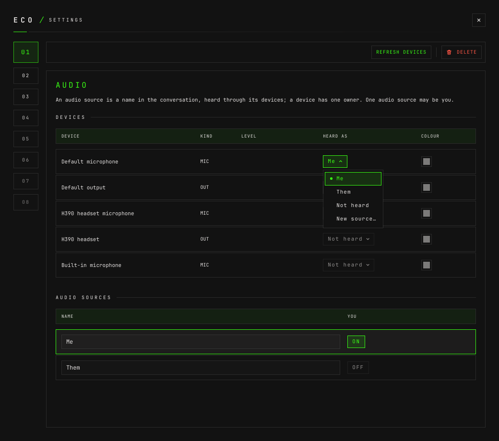

# How to set up audio sources

**The question:** eco should hear me and the people on the call, and know which
voice is mine. How do I tell it what to listen to?

This page is enough on its own. It ends with two audio sources — you, through
your microphone, and everyone else, through what the laptop plays — saved, and
their traces moving on the start screen.

---

An **audio source** is a name in the conversation — `Me`, `Them`,
`Recruiter` — holding one or more PipeWire devices. Every device is captured as
its own stream, so a line already knows whose it is when it is transcribed: your
microphone's lines are yours, without anything having to guess. In the config an
audio source is a `[[participants]]` entry.

## Before you start

- **eco is installed and its window is open.**
  [How to install it and take it off again](how-to-install-and-remove.md).
- **Headphones, if you can.** Without them your microphone also hears the call,
  and their speech comes back as yours. eco has two answers to that (step 4),
  and headphones are still the better one.

---

## 1. Open the Audio section

`SUPER+ALT+C`, or the settings button at the top right of the window. Audio is
the first section (`Ctrl+1`). It holds two tables. The first has a row per
microphone (`MIC`) and output (`OUT`) of the computer: its name, its level, the
source it is **HEARD AS**, and its **COLOUR**. Under it, **AUDIO SOURCES** has a row per
audio source: its name, and **YOU** on yours.


A first config written by hand may already have both sources. Then check each
device's HEARD AS against the steps below, and skip to step 4.

## 2. Add yourself

On the row **Default microphone**, open **HEARD AS** (a click, or `Enter` or
`Space` on the picked row). It lists every source, then **Not heard**, then
**New source…**:



Choose **New source…** and type `Me`. It saves at once: a toast says
`settings saved`, the daemon restarts capture with the device, and `Me` shows
under AUDIO SOURCES. There, press the dim **OFF** chip under **YOU** in the
row of `Me`. It lights as **ON**: your lines
show on the right of the conversation, and the model is told they are yours.
Only one audio source can be you; lighting another dims this one.

Default microphone follows whatever microphone the system uses, so plugging in
a headset needs no change here.

## 3. Add everybody else

On the row **Default output**, open **HEARD AS**, choose **New source…** and
type `Them`. That is what the laptop plays — the call, whatever app it is in.
An output device is captured as what it plays, not as a microphone.

**One output is usually enough.** Every voice on the call arrives through it as
one stream. While the session records, eco tells the voices in that stream
apart: the first keeps the source's name, and the lines of the others move to
`Speaker 1`, `Speaker 2`… a few seconds after they are said; you then name
them.
[How to name the speakers](how-to-name-the-speakers.md) is that part.

**More than one device in a source.** Choose the same source in HEARD AS on
another row. Each device is captured on its own and each is labelled with the
source's name. A device belongs to one source only: choosing a source for a
device another source has moves it, and **Not heard** stops hearing it. Each
saves at once.

**A colour per device.** **COLOUR**, in the device's row, is the colour picker;
a pick saves at once. That colour is its trace's, everywhere a trace is drawn,
and its lines', so you can tell which input hears sound by colour alone.
AUTOMATIC takes one by the device's place among those captured. While a device
has signal, its row draws its live trace, in its colour, under **LEVEL**.

**Renaming a source.** Its **NAME** under AUDIO SOURCES is a field: type, then
`Enter` or leave the field to save; `Esc` puts the old name back.

**A device plugged in since the settings opened** shows once you press
**REFRESH DEVICES** in the bar.

## 4. Choose what to do about echoes

Open **General** (`Ctrl+8`). Under its title **AUDIO**, each is an ON/OFF in
its row, saved at once:

- **DROP ECHOES** — on by default. A line of yours whose words mostly repeat, in
  order, what the others said in the last 20 seconds is their audio leaking into
  your microphone: it is dropped, or taken back if it arrived first. Live
  sessions only.
- **ECHO CANCELLATION** — off by default. While a session records, PipeWire's
  echo canceller removes from your microphone what the **default output** plays.
  It costs about 3% of one core while recording, and only works against the
  default output. On Windows there is none: the switch is dimmed while off,
  and its hint and the note say why; see What can go wrong.

## 5. Watch the traces

Each change saved restarted capture. Close the settings (**×** in the window's
top-right corner, or Esc until they close).

Back on the start screen, each device draws its trace in its colour: flat in
silence, swinging with sound, dashed when the device sends nothing at all.


That is still only measuring. Nothing is transcribed or kept until a session
starts.

---

## In the config file

The same two sources, as the settings window writes them to
`~/.config/eco/config.toml`:

```toml
[[participants]]
name = "Me"
user = true
devices = ["@default-input"]

[[participants]]
name = "Them"
devices = ["@default-output"]

[audio]
drop_echoes = true
echo_cancel = false
```

`@default-input` and `@default-output` follow the system defaults. Any other
device is its PipeWire node name. To see them:

```bash
pw-dump | jq -r '.[] | .info.props? // empty
  | select(.["media.class"]=="Audio/Sink" or .["media.class"]=="Audio/Source")
  | "\(.["media.class"])  \(.["node.name"])"'
```

```
Audio/Sink  alsa_output.pci-0000_c1_00.1.HiFi__HDMI4__sink
Audio/Sink  alsa_output.pci-0000_c1_00.1.HiFi__HDMI3__sink
Audio/Sink  alsa_output.pci-0000_c1_00.1.HiFi__HDMI2__sink
Audio/Sink  alsa_output.pci-0000_c1_00.1.HiFi__HDMI1__sink
Audio/Sink  alsa_output.pci-0000_c1_00.6.HiFi__Speaker__sink
Audio/Source  alsa_input.pci-0000_c1_00.6.HiFi__Headset__source
Audio/Source  alsa_input.pci-0000_c1_00.6.HiFi__Mic1__source
Audio/Sink  alsa_output.usb-Logitech_G522_LIGHTSPEED_-_Wireless_Mode_0000000000000000-00.analog-stereo
Audio/Source  alsa_input.usb-Logitech_G522_LIGHTSPEED_-_Wireless_Mode_0000000000000000-00.mono-fallback
```

`Audio/Source` is a microphone, `Audio/Sink` an output.

On Windows the devices are the WASAPI endpoints: every active capture
endpoint is a microphone (`MIC`), every active render endpoint an output
(`OUT`), captured as what it plays. Any device other than the two defaults is
its endpoint id, as Windows names it (`{0.0.1.00000000}.{…}` for a microphone,
`{0.0.0.00000000}.{…}` for an output); the Audio table shows each with its name, such
as `Microphone (USB Audio Device)` or `Speakers (High Definition Audio Device)`.

On macOS the devices are the Core Audio devices, each by its UID, such as
`BuiltInSpeakerDevice`, with its name, such as `Alto-falantes (Mac mini)`. A
device that is both a microphone and an output, such as some USB headsets, is
listed once, as a microphone: what it plays cannot be captured. A device's trace colour is
`[colors]`, by device: `"@default-input" = "#ffb000"`. The daemon reads the file
when it starts, so a hand edit needs `eco restart`.

---

## What can go wrong

**A device is not there.** A device a source names that the computer does not
have shows dim in the Audio table, as unavailable, and the daemon skips it rather than let `pw-record` fall back to the default device
silently. During a session the capsule shows a warning for an input that sends
no audio, and an error toast says which: `Them: <device> is not connected`.

**Nobody is configured.** The new-session dialog says
`No input configured: nothing would be heard.`, offers **AUDIO SETTINGS**, and
does not start.

**Deleting a source.** Pick it under AUDIO SOURCES and press **DELETE**. It asks
first, and says what changes: the devices no longer heard, `Nobody else is
heard: no other audio source has an output device.` when it held the only
output, and `No audio source is you any more.` when it was you.

**Echo cancellation would not start.** An error toast says
`Echo cancellation is off: <why>`, and eco records from the raw microphone.

**A microphone heard as silence on macOS.** macOS gives a microphone it has
not allowed eco only silence, and says nothing. Allow eco, or the terminal it
runs in, under **System Settings › Privacy & Security › Microphone**, then
start the session again.

**Echo cancellation on Windows and macOS.** Neither offers eco one: the ECHO
CANCELLATION row is dimmed. With `echo_cancel = true` in a config written by
hand, each recording says
`Echo cancellation is not available on this system; the microphone is heard as it is`,
and eco records from the raw microphone. Set it to `false`, and use DROP ECHOES
or headphones.

**The config refuses a device in two sources, or two sources that are you:**
`a device can belong to one participant only`,
`only one participant can be the user`.

---

## Next

- [How to register models](how-to-register-models.md) — what transcribes what
  these sources hear.
- [How to record a session](how-to-record-a-session.md) — the first time any of
  it is kept.
- [`design.md` §4](design.md#4-audio) — capture, the VAD, echoes and live
  voices, in full.
